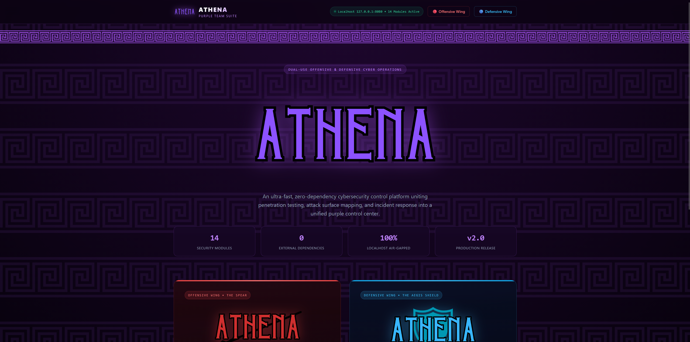
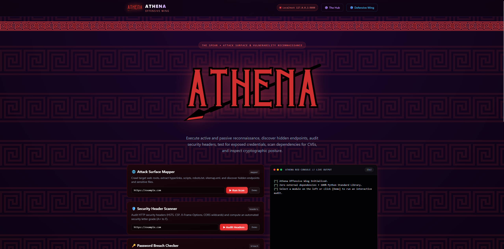
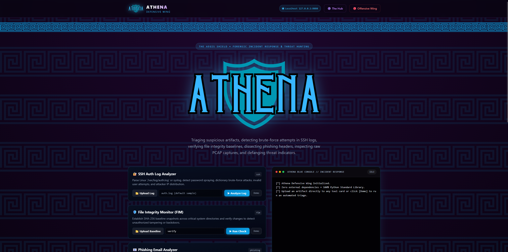

# 🦉 Athena-Web - Full-Stack Purple Team Security Platform

```text
      █████╗ ████████╗██╗  ██╗███████╗███╗   ██╗ █████╗ 
     ██╔══██╗╚══██╔══╝██║  ██║██╔════╝████╗  ██║██╔══██╗
     ███████║   ██║   ███████║█████╗  ██╔██╗ ██║███████║
     ██╔══██║   ██║   ██╔══██║██╔══╝  ██║╚██╗██║██╔══██║
     ██║  ██║   ██║   ██║  ██║███████╗██║ ╚████║██║  ██║
     ╚═╝  ╚═╝   ╚═╝   ╚═╝  ╚═╝╚══════╝╚═╝  ╚═══╝╚═╝  ╚═╝
              [ Athena Purple Team Suite v2.0 ]
       -- Full-Stack Localhost SOC & Recon Platform --
```

[](LICENSE)
[](https://www.python.org/)
[-brightgreen.svg)](#architecture)
[](#security--privacy)

**Athena-Web** is an interactive, browser-based cybersecurity control center that unifies penetration testing, attack surface mapping, and digital forensics into a cohesive **Purple Team Platform**.

Featuring a mythological cyber aesthetic with **translucent Greek Meander watermarks**, Athena-Web provides real-time asynchronous tool execution, live streaming terminal outputs, drag-and-drop forensic artifact triage, and one-click incident report downloads - **powered 100% by the Python standard library with zero external pip dependencies**.

> 💻 **Prefer the Command Line?** Check out [**Athena-CLI**](https://github.com/Sonelu24/Athena-CLI) - our companion terminal suite with an interactive TUI menu, 14 standalone subcommands, and native Kali Linux integration.

---

## 🏛️ Visual Architecture & Dual Wings

Athena-Web separates cybersecurity operations into three specialized views:

### 1. 🟣 The Hub (`/`)
- **Atmosphere:** Deep obsidian & dark purple gradient.
- **Greek Meander Motif:** Translucent purple Greek key watermark across the canvas.
- **Mission Control:** Live status indicator, module metrics (14 tools active, 0 dependencies), and split portals to enter either wing.



### 2. 🔴 The Offensive Wing • The Spear (`/red`)
- **Atmosphere:** Crimson red & dark charcoal gradient.
- **Greek Meander Motif:** Translucent crimson-red Greek meander watermark and borders.
- **Offensive Modules:**
  - `mapper`: Web attack surface crawler & hidden endpoint discoverer.
  - `headers`: HTTP security header auditor & CORS posture scanner (Grade A+ to F).
  - `breach`: k-Anonymity password exposure verifier via HaveIBeenPwned API.
  - `cve`: Software dependency vulnerability scanner (OSV.dev & NIST NVD).
  - `jwt`: JWT security auditor (alg:none bypass & HMAC secret recovery).
  - `tls`: TLS certificate expiry, cipher suite, and intermediate CA inspector.
  - `php2shell-audit`: Web upload form exposure & extension bypass auditor.
- **Live Console:** Monospace terminal with real-time job streaming, copy, and `.txt` report export.



### 3. 🔵 The Defensive Wing • The Aegis Shield (`/blue`)
- **Atmosphere:** Deep navy blue & night-sky black gradient.
- **Greek Meander Motif:** Translucent electric-blue Greek meander watermark and borders.
- **Defensive Modules:**
  - `ssh`: Linux auth.log & Windows security log brute-force attack triage.
  - `fim`: File Integrity Monitor with SHA-256 baselining & tamper detection.
  - `phishing`: Forensic email analyzer (SPF/DKIM/DMARC auth & lookalike domains).
  - `pcap`: Binary packet capture threat hunter (zero Scapy/Wireshark required).
  - `malware`: Shannon entropy auditor & PE/ELF static binary triage.
  - `ioc`: Threat indicator extractor & URL defanger (`hxxp[://]`).
  - `php2shell-detect`: Webroot scanner & access log webshell hunter.
- **Direct Forensic Artifact Upload:** Upload buttons on each forensic tool card with multi-layer file extension validation (PCAP, EML, logs, baselines, binaries).



---

## ⚡ Architecture & Design Principles

- **Zero External Dependencies:** Built entirely with Python's built-in `http.server.ThreadingHTTPServer`, `subprocess`, `urllib`, `json`, `hashlib`, and `email.message_from_bytes`. Zero `pip install` commands required.
- **Asynchronous Job Worker Engine:** Multi-threaded non-blocking execution engine. Subprocesses execute in isolated background threads while real-time stdout/stderr streams to the client via REST polling.
- **Strictly Localhost & Air-Gapped:** Binds strictly to `127.0.0.1:8080`. Handled incident logs, passwords, memory dumps, and captured PCAPs never transmit to external cloud services.
- **Pure Vanilla Frontend:** Clean HTML5, CSS3, and modern Vanilla JavaScript without external frameworks, CDNs, or node_modules.

---

## 🚀 Quickstart

### 1. Clone & Run
```bash
git clone https://github.com/Sonelu24/Athena-Web.git
cd Athena-Web

# Start the web server (binds to http://127.0.0.1:8080)
python app.py
```

### 2. Access the Platform
Open your browser to:
```
http://127.0.0.1:8080
```

---

## 🔌 REST API Endpoints

Athena-Web includes an air-gapped REST API for automation and script integration:

| Method | Endpoint | Description |
|---|---|---|
| `GET` | `/api/status` | System health check, active jobs count, server uptime |
| `GET` | `/api/tools` | Complete catalog of available Red & Blue tools and metadata |
| `POST` | `/api/run` | Execute a tool asynchronously (`{"tool": "jwt", "args": ["--demo"]}`) |
| `GET` | `/api/job/<job_id>` | Poll job execution state, exit code, and captured stdout/stderr |
| `POST` | `/api/upload` | Multipart file upload endpoint saving artifacts to local `uploads/` sandbox |

---

## ⚖️ Legal & Ethical Notice

Athena is developed strictly for authorized cybersecurity education, academic research, CTF competitions, and professional penetration testing / SOC operations conducted under explicit, written permission. 

Scanning, probing, or testing credentials against systems without prior legal authorization violates computer crime laws, including the Computer Fraud and Abuse Act (CFAA) and equivalent international statutes. The authors disclaim all liability for misuse.

---

## 📄 License & Attribution

- **Author:** Alexandru Iosif Mocanu (Sonelu)  
- **License:** Distributed under the **MIT License**. See [`LICENSE`](LICENSE) for details.  
- **Copyright:** &copy; 2026 Alexandru Iosif Mocanu (Sonelu). All rights reserved.
